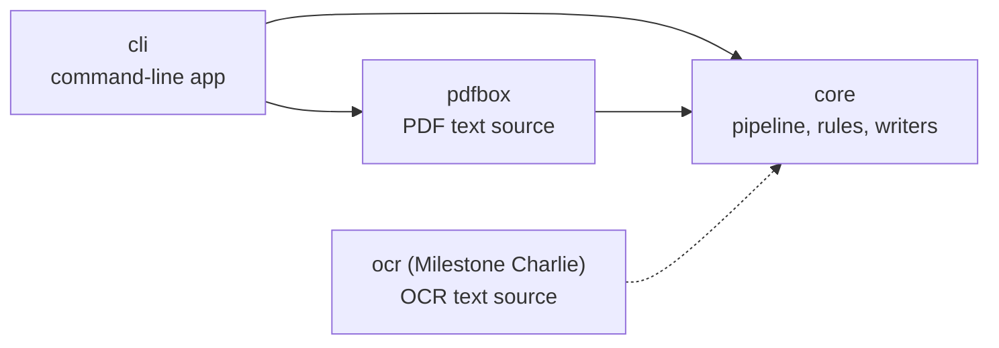
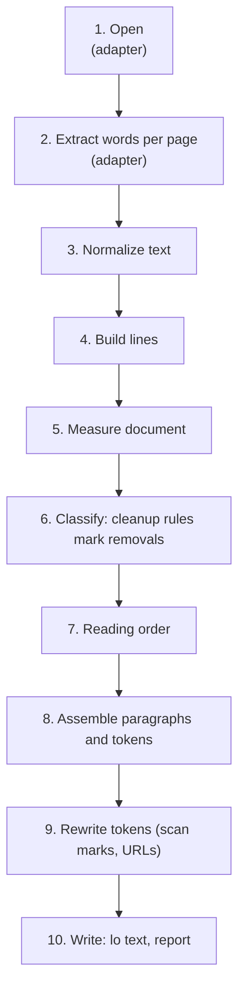

# Architecture

How Audio Press is built, why, and how it is tested. User-facing behavior is specified in [usage.md](usage.md) and [cleanup-rules.md](cleanup-rules.md), and the API for code that uses the engine as a library is in [api.md](api.md).

## Goals

1. **Audiobook-quality text.** The transcript is meant to be listened to. Anything a listener would find jarring (headers, footers, page numbers, footnote markers, legal boilerplate, full URLs, page breaks) is removed or rewritten.
2. **Simple and predictable.** Cleanup is a short list of named rules with documented thresholds. Every removal is recorded with the rule that made it, so a user can see exactly what happened and switch a rule off.
3. **Built for the later milestones.** Alpha only writes lo output from text-based PDFs, but the design already carries what Bravo, Charlie, and Delta need: a page position for every word, a swappable text source, and swappable output writers.
4. **Reusable core.** The processing engine does not depend on the PDF library or the command line, so it can be wrapped into a larger (likely Android) app later.

## Modules

The engine is one Gradle build with three modules, in the ports-and-adapters style. The build lives in `engine/`, and nothing in it refers to the app.



| Module | Responsibility | May depend on |
|---------|----------------|---------------|
| `core` | Data model, pipeline, cleanup rules (`core.rules`), paragraph assembly, output writers, report. Defines the `TextSource` port. | Kotlin standard library only |
| `pdfbox` | `PdfBoxTextSource`: reads a PDF with Apache PDFBox and turns each page into positioned words. | `core`, PDFBox |
| `cli` | Argument parsing, file handling, exit codes, messages. Wires the adapter into the core. | `core`, `pdfbox`, Clikt |

Every module uses the package `io.github.tjnewbry.audiopress` plus its own name (`.core`, `.pdfbox`, `.cli`). Gradle stops `core` from importing PDFBox, Clikt, or the other modules, because it does not depend on them, and `ArchitectureTest` additionally fails the build if `core` uses desktop-only APIs such as `java.awt`. So `core` stays usable from Android, where the app uses it as a library ([api.md](api.md)).

## Pipeline

A conversion is a fixed sequence of stages. Each stage takes an immutable value and returns a new one.



| # | Stage | Module | Input → Output | Notes |
|---|-------|---------|----------------|-------|
| 1 | Open | `pdfbox` | file → `TextSource` | Typed errors for missing, corrupt, or encrypted files (see [Errors](#errors-and-diagnostics)). |
| 2 | Extract | `pdfbox` | page index → `SourcePage` | Only pages selected with `--pages` are read. Words are split where the baseline shifts, so superscript footnote markers become separate words. |
| 3 | Normalize | `core` | words → words | Ligatures, special spaces, invisible characters, superscript digits. See [cleanup-rules.md](cleanup-rules.md#text-normalization). |
| 4 | Build lines | `core` | words → `Line`s per page | Words are grouped by vertical overlap, then sorted left to right. |
| 5 | Measure | `core` | pages → `DocumentStats` | Body font size and line pitch. Rules use these instead of fixed point sizes, so they work across book formats. |
| 6 | Classify | `core` | layout → `Removal`s | Ordered cleanup rules. A rule never deletes anything; it returns removals (page, line, or word, plus the rule ID and reason). Later rules can see earlier removals. |
| 7 | Reading order | `core` | lines → ordered lines | Top to bottom on single-column pages. One function, so a column-aware version can replace it later. |
| 8 | Assemble | `core` | lines → `Transcript` | Joins lines into paragraphs and headings across line and page breaks, and rejoins hyphenated words. Every token keeps the page positions of the words it came from. |
| 9 | Rewrite | `core` | `Transcript` → `Transcript` | Token rewrites that keep positions: footnote marks garbled by scanning, then URLs. |
| 10 | Write | `core` | `ConversionResult` → text | `LoTextWriter` now, a hi writer in Bravo. `ReportWriter` lists every removal and warning. |

## Data model

The main types, simplified from the code:

```kotlin
// Port: implemented by PdfBoxTextSource now, and by an OCR source in Milestone Charlie.
interface TextSource : AutoCloseable {
    val pageCount: Int
    fun readPage(pageIndex: Int): SourcePage                 // 1-based physical page number
}
data class SourcePage(val index: Int, val width: Float, val height: Float, val words: List<SourceWord>)
data class SourceWord(
    val text: String, val box: Box, val baseline: Float, val fontSize: Float,
    val horizontal: Boolean,                                  // false for rotated or vertical text
    val joinsPrevious: Boolean,                               // no space before it (split from the same PDF word)
)

// Layout: per page, geometric.
data class Line(val page: Int, val index: Int, val words: List<SourceWord>)   // box, fontSize, baseline, text derived
data class LayoutPage(val index: Int, val width: Float, val height: Float, val lines: List<Line>)
data class LayoutDocument(val pages: List<LayoutPage>, val pageCount: Int)    // plus stats: DocumentStats

// Cleanup decisions.
interface CleanupRule { val id: RuleId; fun apply(document: LayoutDocument, removed: Removals): List<Removal> }
data class Removal(val rule: RuleId, val target: Target, val text: String, val reason: String)  // PageTarget, LineTarget, or WordTarget

// Transcript: logical, crosses page boundaries.
data class Transcript(val segments: List<Segment>)
data class Segment(val kind: SegmentKind, val tokens: List<Token>)          // PARAGRAPH or HEADING
data class Token(val text: String, val spaceBefore: Boolean, val spans: List<Span>)
data class Span(val page: Int, val box: Box)                               // two spans for a word hyphenated across lines

// Entry point and output.
class Converter(rules: List<CleanupRule> = DefaultRules.all) {
    fun convert(source: TextSource, sourceName: String, options: ConversionOptions): ConversionResult
}
interface TranscriptWriter { fun write(transcript: Transcript, out: Appendable) }
```

**Coordinates.** All positions use display space: PDF points (1/72 inch), origin at the top-left of the page as a viewer shows it, y increasing downward. The PDFBox adapter converts into this space, so the core and every output format share one convention.

**Token positions.** A token's page is the page of its first span. Pieces split from one PDF word (such as `H`, `2`, `O`) are merged back into one token, after footnote markers are removed.

## Design decisions

Each decision with real alternatives, and why it was made.

| Decision | Why | Rejected alternatives |
|----------|-----|-----------------------|
| **Apache PDFBox 3** for text extraction | Mature, Apache-licensed, and gives per-character positions and font sizes, which lo needs now and the hi word map needs later. PDFBox's word splitting is reused; line building and everything after it is done in `core`. | iText and MuPDF (AGPL, incompatible with MIT); Poppler `pdftotext` (GPL, an extra install, less per-character data); OpenPDF (weak extraction). |
| **Three Gradle modules** (`core`, `pdfbox`, `cli`) in one build | Gradle enforces the boundary: `core` depends only on the Kotlin standard library, so the Android app can use it without PDFBox. This replaced an earlier single-module design once the app became a second consumer. Shared build settings live in the engine's root build script, which is fine for three modules; move them to a convention plugin if it grows. | A single module with packages (the boundary is only a test); a convention plugin in `build-logic` (more build setup than three modules need). |
| **Rules mark removals; a separate stage assembles the text** | Makes cleanup explainable (`--report`), lets rules be switched off independently, and keeps every word's position for hi output. | In-place regex cleanup (order-dependent, hard to explain, loses positions); a statistical classifier (unpredictable). |
| **lo is plain UTF-8 text with `[[page N]]` lines** | Any TTS engine can read it, markers strip with one regex, and page boundaries are exact, even mid-paragraph. Other formats can be added as more `TranscriptWriter`s. | Markers only between paragraphs (loses which part of a paragraph is on which page); form feeds (no page number); JSON or SSML as lo (not "simple TXT"). |
| **Clikt** for argument parsing (`clikt-core`, without the terminal-styling library) | The standard Kotlin CLI library: typed options, validation, and generated help. The core variant avoids native-access warnings on new JDKs. | kotlinx-cli (no longer developed); picocli (annotation-based, Java-first); a hand-written parser. |
| **JDK 25 toolchain, Java 17 bytecode** | The program runs on any Java 17+ runtime, including the Java 17 that is first on the development machine's PATH, and stays usable on Android. | Java 25 bytecode (would not start on Java 17). |
| **ktlint through Spotless; warnings as errors** | One command (`./gradlew build`) checks formatting and compiles cleanly. `spotlessApply` fixes formatting. Detekt is left out until it supports Kotlin 2.4. | Formatting by hand. |
| **Generated test PDFs and golden files** | Books are usually copyrighted, so committed tests build their own PDFs with known content and compare the output with hand-written expected transcripts. | Committing public-domain PDFs (large binaries, expected output still hand-written). |

## Testing

| Level | What is tested | How |
|-------|----------------|-----|
| Unit (`core`) | Each cleanup rule (including a case where it must not fire), normalization, line building, assembly, URL and scan-mark rewrites, the lo writer. | Layouts built in memory with `TestLayouts`, so no PDF is needed. |
| Adapter (`pdfbox`) | Words, positions, font sizes, superscript splitting, rotated text, and missing, non-PDF, damaged, and password-protected files. | PDFs generated in the test with `FixturePdf`, which the pdfbox module shares with the cli tests as test fixtures. |
| End to end (`cli`) | Options, exit codes, output files, and the full pipeline. | `MiniBook`, a generated six-page book, compared with `cli/src/test/resources/golden/*.txt`. After an intended behavior change, regenerate with `./gradlew test -Pgolden.update=true` and review the diff. |
| Architecture | `core` does not use desktop-only APIs (Gradle already blocks PDFBox and the CLI). | `ArchitectureTest` scans the sources. |
| Manual | Real-world books. | PDFs in the git-ignored `local-samples/` folder (inside `engine/`), converted with `--report` into `local-samples/out/`. |

Tests never use the network, and real books are never committed. GitHub Actions runs `./gradlew build` from the `engine/` folder on every push and pull request that touches `engine/`.

## Errors and diagnostics

* **Typed errors.** The core and adapter throw subclasses of a sealed `AudioPressException`. Only the CLI turns them into messages and exit codes ([usage.md](usage.md#exit-codes)). Unexpected exceptions become exit code 1, with a stack trace only with `--verbose`.
* **Encryption and permissions.** PDFs protected only by an owner password open normally. PDFs that need a user password are rejected. If a PDF forbids text extraction, Audio Press still proceeds when the PDF allows extraction for accessibility (this is an accessibility use); otherwise it stops with a clear message.
* **Warnings** do not stop a conversion. In Alpha the only warning is for a page with no text layer (probably a scanned image). If no selected page has text, the conversion fails with exit code 4.
* **Output** is written to a temporary file and moved into place at the end, so a failed run never leaves a half-written transcript.
* **Logging.** There is no logging framework. PDFBox's own log output is silenced unless `--verbose` is set.

## Performance

A 500-page book should convert in under 60 seconds; the sample books convert at roughly 40 to 115 pages per second. The layout of all selected pages is kept in memory (roughly 100 MB for 1,000 pages), because running-header detection compares nearby pages.

## Using the engine from an Android app

The app depends on the `core` module only, through the API in [api.md](api.md). What it needs to know:

* **PDFBox does not run on Android**, so the app cannot use the `pdfbox` module. It must supply its own `TextSource` that reads PDFs on the phone, or send PDFs to a server that runs the engine. Which to do is an open decision, pending research.
* **Memory.** The layout of every selected page is kept in memory, about 100 MB per 1,000 pages. That is comfortable on a desktop JVM and has not been measured on a phone. A sliding window of pages is possible if it matters.
* **Word positions are approximate.** Each word's box is estimated from its font size (80% of it above the baseline, 20% below), not from the font's real metrics. That is fine for cleanup but not accurate enough to highlight words as they are read. Milestone Bravo needs exact boxes.
* **Output limits.** Equations read poorly, and scanned books with an OCR text layer can contain OCR errors; see [Known limits](#known-limits-in-alpha).
* **Untested on Android.** `core` is compiled to Java 17 bytecode and uses only the Kotlin and Java standard libraries, but it has not yet been built into an Android app, so details such as Java API availability are unverified.

## Extension points for later milestones

| Milestone | What it needs | Where it plugs in |
|-----------|---------------|-------------------|
| Bravo (hi output) | Word positions and character offsets | A new `TranscriptWriter` that reads `Token.spans`, plus a `--mode lo|hi` option. See the [draft format](#hi-format-draft). |
| Charlie (scans, lo) | Words from page images | A new `TextSource` in an `ocr` module, possibly used only for pages without a text layer. Everything after stage 2 is unchanged. |
| Delta (scans, hi) | OCR word positions | OCR engines report word boxes, so the OCR source fills the same `SourceWord.box`. |
| Multi-column pages | Column-aware ordering | Splitting lines at wide gaps (stage 4) and a column-aware reading order (stage 7). |
| Android app | Reuse of the engine | `core` is its own module and the app uses it as a library ([api.md](api.md)); add an Android-compatible `TextSource`, because PDFBox does not run on Android. |

### hi format (draft)

A draft for Milestone Bravo, included so the lo format and the internal model support it. It will be finalized in Bravo.

* hi mode writes the same lo text file **and** a word map next to it (`book.map.json`).
* The map is organized by paragraph, so an app can speak one paragraph per utterance and highlight words from Android's `UtteranceProgressListener.onRangeStart(utteranceId, start, end, frame)` callback.
* Character offsets are UTF-16 indexes into the paragraph's `text` (how Java, Kotlin, and Android index strings), so the callback's `start` and `end` can be looked up directly.

```json
{
  "format": "audio-press-map",
  "formatVersion": 1,
  "source": { "file": "book.pdf", "pageCount": 412 },
  "pages": [{ "page": 7, "width": 432.0, "height": 648.0 }],
  "paragraphs": [
    {
      "id": 0,
      "kind": "heading",
      "text": "CHAPTER ONE",
      "words": [
        { "start": 0, "end": 7, "boxes": [{ "page": 7, "left": 180.2, "top": 96.0, "right": 236.9, "bottom": 110.4 }] },
        { "start": 8, "end": 11, "boxes": [{ "page": 7, "left": 240.1, "top": 96.0, "right": 268.3, "bottom": 110.4 }] }
      ]
    }
  ]
}
```

A word hyphenated across a line or page break has two boxes. A rewritten word (such as a URL shortened to its domain) keeps the boxes of the original text.

## Known limits in Alpha

* Multi-column pages are read line by line across the columns.
* Tables, sidebars, and figure captions are read as ordinary lines unless a rule removes them.
* Equations read poorly, and math exponents (`x²`) are removed like footnote markers unless `footnote-markers` is disabled.
* Scanned books with an OCR text layer can still contain OCR errors; reading scans properly is Milestone Charlie.
* Word boxes are estimated from the font size, not exact (see [Using the engine from an Android app](#using-the-engine-from-an-android-app)).
* Drop caps, and right-to-left or vertical scripts, are not supported.
